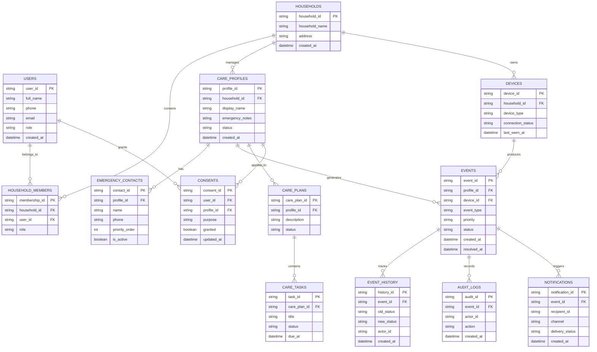

# CARE LOOP — DATABASE SCHEMA

**Version:** 1.0  
**Date:** 19 November 2026  
**Database Strategy:** SQLite for MVP, PostgreSQL for future deployment.

---

## 1. Database Objectives

The database stores the information required to manage household safety events and coordinate care activities.

Main objectives:

- Maintain elderly user profiles.
- Manage households and emergency contacts.
- Register devices.
- Store safety events.
- Track event lifecycle transitions.
- Record human actions.
- Maintain consent and audit information.
- Support future care plans and tasks.

The schema is a proposed logical model. Existing SQLite tables should be inspected before migration.

---

## 2. Entity Relationship Diagram



---

## 3. Core Entities

### 3.1. USERS

Stores platform account information.

| Field      | Type        | Description        |
| ---------- | ----------- | ------------------ |
| user_id    | UUID / TEXT | Primary key        |
| full_name  | TEXT        | User name          |
| phone      | TEXT        | Contact number     |
| email      | TEXT        | Email              |
| role       | TEXT        | Account role       |
| is_active  | BOOLEAN     | Account status     |
| created_at | DATETIME    | Creation timestamp |
| updated_at | DATETIME    | Last update        |

Proposed roles:

- ELDERLY.
- FAMILY.
- CAREGIVER.
- COORDINATOR.
- ADMIN.

These roles require authorization rules before being used in a real deployment.

### 3.2. HOUSEHOLDS

Represents a household participating in CARE LOOP.

| Field          | Type     | Description                          |
| -------------- | -------- | ------------------------------------ |
| household_id   | TEXT     | Primary key                          |
| household_name | TEXT     | Display name                         |
| address        | TEXT     | Household address, access-controlled |
| status         | TEXT     | ACTIVE / INACTIVE                    |
| created_at     | DATETIME | Creation time                        |

### 3.3. HOUSEHOLD_MEMBERS

Associates users with households.

| Field         | Type     | Description       |
| ------------- | -------- | ----------------- |
| membership_id | TEXT     | Primary key       |
| household_id  | TEXT     | Foreign key       |
| user_id       | TEXT     | Foreign key       |
| role          | TEXT     | Household role    |
| joined_at     | DATETIME | Membership date   |
| is_active     | BOOLEAN  | Membership status |

A user may belong to multiple households.

### 3.4. CARE_PROFILES

Stores care-related information about an elderly person.

| Field           | Type     | Description                    |
| --------------- | -------- | ------------------------------ |
| profile_id      | TEXT     | Primary key                    |
| household_id    | TEXT     | Foreign key                    |
| display_name    | TEXT     | Display name                   |
| date_of_birth   | DATE     | Optional                       |
| emergency_notes | TEXT     | Relevant emergency information |
| access_notes    | TEXT     | Access arrangements            |
| status          | TEXT     | ACTIVE / INACTIVE              |
| created_at      | DATETIME | Creation time                  |

Sensitive information must be optional and access-controlled.

### 3.5. EMERGENCY_CONTACTS

Stores designated response contacts.

| Field          | Type    | Description                 |
| -------------- | ------- | --------------------------- |
| contact_id     | TEXT    | Primary key                 |
| profile_id     | TEXT    | Foreign key                 |
| user_id        | TEXT    | Optional associated account |
| name           | TEXT    | Contact name                |
| phone          | TEXT    | Phone number                |
| priority_order | INTEGER | Contact order               |
| relationship   | TEXT    | Relationship                |
| is_active      | BOOLEAN | Availability                |

Recommended constraint:

```sql
UNIQUE(profile_id, priority_order)
```

### 3.6. DEVICES

Stores household device metadata.

| Field             | Type     | Description                |
| ----------------- | -------- | -------------------------- |
| device_id         | TEXT     | Primary key                |
| household_id      | TEXT     | Foreign key                |
| device_type       | TEXT     | SOS / CAMERA / PIR / RADAR |
| manufacturer      | TEXT     | Manufacturer               |
| model             | TEXT     | Device model               |
| firmware_version  | TEXT     | Firmware version           |
| connection_status | TEXT     | ONLINE / OFFLINE / UNKNOWN |
| battery_level     | INTEGER  | Optional percentage        |
| last_seen_at      | DATETIME | Last heartbeat             |
| created_at        | DATETIME | Registration time          |

Do not store device credentials in plain text.

### 3.7. EVENTS

The central entity of the platform.

| Field           | Type     | Description                   |
| --------------- | -------- | ----------------------------- |
| event_id        | TEXT     | Primary key                   |
| profile_id      | TEXT     | Related Care Profile          |
| device_id       | TEXT     | Optional source device        |
| event_type      | TEXT     | SOS / FALL / DEVICE_OFFLINE   |
| priority        | TEXT     | P0–P4                         |
| status          | TEXT     | Lifecycle status              |
| source          | TEXT     | APP / DEVICE / AI / SIMULATOR |
| description     | TEXT     | Short event description       |
| metadata_json   | TEXT     | Structured metadata           |
| created_at      | DATETIME | Event creation                |
| acknowledged_at | DATETIME | Acknowledgement time          |
| resolved_at     | DATETIME | Resolution time               |
| resolved_by     | TEXT     | Actor                         |
| resolution_note | TEXT     | Outcome                       |

Important:

- `event_id` must be unique.
- `created_at` should be stored in UTC.
- Metadata must not contain unnecessary raw video.
- Event source must be distinguishable.

### 3.8. EVENT_HISTORY

Records lifecycle changes.

| Field      | Type     | Description       |
| ---------- | -------- | ----------------- |
| history_id | TEXT     | Primary key       |
| event_id   | TEXT     | Foreign key       |
| old_status | TEXT     | Previous status   |
| new_status | TEXT     | New status        |
| actor_id   | TEXT     | Responsible actor |
| reason     | TEXT     | Transition reason |
| created_at | DATETIME | Transition time   |

### 3.9. AUDIT_LOGS

Records important actions.

| Field         | Type     | Description       |
| ------------- | -------- | ----------------- |
| audit_id      | TEXT     | Primary key       |
| event_id      | TEXT     | Optional event    |
| actor_id      | TEXT     | User or system    |
| action        | TEXT     | Action name       |
| target_type   | TEXT     | Target entity     |
| target_id     | TEXT     | Target identifier |
| metadata_json | TEXT     | Action metadata   |
| created_at    | DATETIME | Timestamp         |

Audit records should be append-only for normal application operations.

### 3.10. NOTIFICATIONS

Proposed notification records.

| Field              | Type     | Description                       |
| ------------------ | -------- | --------------------------------- |
| notification_id    | TEXT     | Primary key                       |
| event_id           | TEXT     | Foreign key                       |
| recipient_id       | TEXT     | Recipient                         |
| channel            | TEXT     | IN_APP / SMS / VOICE              |
| delivery_status    | TEXT     | PENDING / SENT / FAILED / UNKNOWN |
| provider_reference | TEXT     | Optional provider ID              |
| attempted_at       | DATETIME | Attempt time                      |
| delivered_at       | DATETIME | Delivery confirmation             |

A sent notification is not equivalent to a delivered notification or an acknowledged event.

### 3.11. CARE_PLANS

Stores agreed care arrangements.

| Field        | Type     | Description           |
| ------------ | -------- | --------------------- |
| care_plan_id | TEXT     | Primary key           |
| profile_id   | TEXT     | Foreign key           |
| description  | TEXT     | Care plan description |
| created_by   | TEXT     | Author                |
| status       | TEXT     | ACTIVE / INACTIVE     |
| created_at   | DATETIME | Creation              |

### 3.12. CARE_TASKS

Stores individual care activities.

| Field        | Type     | Description                     |
| ------------ | -------- | ------------------------------- |
| task_id      | TEXT     | Primary key                     |
| care_plan_id | TEXT     | Foreign key                     |
| title        | TEXT     | Task title                      |
| description  | TEXT     | Optional detail                 |
| assigned_to  | TEXT     | Responsible user                |
| due_at       | DATETIME | Due time                        |
| status       | TEXT     | PENDING / COMPLETED / CANCELLED |
| completed_at | DATETIME | Completion time                 |

### 3.13. CONSENTS

Records user consent.

| Field          | Type     | Description        |
| -------------- | -------- | ------------------ |
| consent_id     | TEXT     | Primary key        |
| user_id        | TEXT     | Related user       |
| profile_id     | TEXT     | Related profile    |
| purpose        | TEXT     | Data usage purpose |
| granted        | BOOLEAN  | Consent state      |
| policy_version | TEXT     | Applicable policy  |
| updated_at     | DATETIME | Update time        |
| withdrawn_at   | DATETIME | Withdrawal time    |

Consent must be recorded per purpose, not as one blanket permission.

---

## 4. Database Constraints

Recommended constraints:

1. Primary keys must be unique.
2. Foreign keys must reference valid records.
3. Emergency contact priority must be unique within a profile.
4. Event status values must follow the lifecycle specification.
5. Priority values must follow P0–P4.
6. Timestamps must use a consistent UTC convention.
7. Event metadata must be valid JSON.
8. Audit records should not be silently overwritten.
9. Deletion of records must respect retention and legal requirements.

---

## 5. Recommended Indexes

```sql
CREATE INDEX idx_events_profile
ON events(profile_id);

CREATE INDEX idx_events_status
ON events(status);

CREATE INDEX idx_events_created
ON events(created_at);

CREATE INDEX idx_events_priority
ON events(priority);

CREATE INDEX idx_event_history_event
ON event_history(event_id);

CREATE INDEX idx_audit_event
ON audit_logs(event_id);

CREATE INDEX idx_devices_household
ON devices(household_id);
```

The SQL is a proposed target schema. Before applying it, compare table and column names against the existing SQLite implementation.

---

## 6. Database Migration Strategy

### MVP

- Continue using SQLite.
- Preserve existing event records.
- Preserve audit history.
- Add new tables incrementally.
- Use versioned migration scripts.

### Pilot

- Introduce PostgreSQL when multi-user deployment requires it.
- Add stronger transactional controls.
- Configure backup and restore.
- Introduce database monitoring.

### Expansion

- Evaluate partitioning for large event histories.
- Introduce retention policies.
- Consider read replicas if justified by workload.

---

## 7. Data Retention

Proposed retention categories:

| Data                 | Policy                                                      |
| -------------------- | ----------------------------------------------------------- |
| Account information  | While account is active, subject to applicable requirements |
| Event records        | Defined operational retention period                        |
| Audit logs           | Defined security and accountability retention               |
| Sensor metadata      | Minimum period required for the purpose                     |
| Video clips          | Off by default; separate consent and retention policy       |
| Notification records | Retain only as operationally necessary                      |

Exact retention periods require legal and operational review.

---

## 8. Acceptance Criteria

- Core entities are documented.
- Relationships are defined.
- Primary and foreign keys are identified.
- Event and audit history are separated.
- Consent is represented independently.
- Existing prototype data is preserved during migration.
- Future PostgreSQL migration is feasible.

**Database principle: The event record describes what happened; the event history describes how it changed; the audit log describes who performed an action.**
