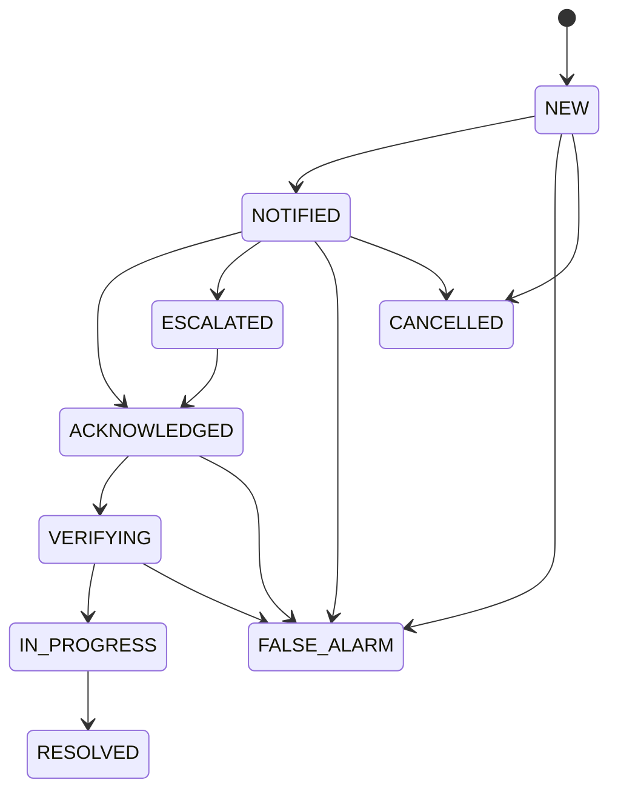

# CARE LOOP — EVENT ENGINE DESIGN

**Version:** 1.0  
**Date:** 19 November 2026  
**Module:** Event Processing & Response Coordination

---

## 1. Purpose

The Event Engine manages safety-related events from initial signal reception to final resolution.

Its primary responsibilities are:

- Validate incoming events.
- Classify event types and priorities.
- Manage event lifecycle.
- Trigger notification workflows.
- Monitor acknowledgement.
- Execute configured escalation rules.
- Record human response.
- Preserve event history.

The Event Engine is not a medical diagnosis system.

---

## 2. Event Categories

| Event Type      | Description                           | Example             |
| --------------- | ------------------------------------- | ------------------- |
| SOS             | User explicitly requests assistance   | Physical SOS button |
| SUSPECTED_FALL  | AI or sensor detects a potential fall | Camera-based alert  |
| IMMOBILITY      | Unusual prolonged inactivity          | Sensor-based signal |
| MISSED_CHECK_IN | Expected check-in is missed           | Scheduled check     |
| DEVICE_OFFLINE  | Device loses connectivity             | Missing heartbeat   |
| LOW_BATTERY     | Device battery is low                 | Battery threshold   |
| SYSTEM_ERROR    | Technical processing failure          | Inference failure   |

Event type and event priority are separate attributes.

---

## 3. Priority Classification

The following priority levels are proposed operational labels.

| Priority | Description                    | Response Approach                 |
| -------- | ------------------------------ | --------------------------------- |
| P0       | Potentially critical situation | Immediate human attention         |
| P1       | High-priority safety concern   | Prompt verification               |
| P2       | Important follow-up required   | Follow configured response window |
| P3       | Device or technical issue      | Technical follow-up               |
| P4       | Informational event            | Record and review                 |

Priority assignment depends on event type, source, context, and available evidence.

An AI-generated fall alert must not automatically be represented as a medically confirmed fall.

A potential life-threatening emergency must be handled through appropriate official emergency channels.

---

## 4. Event Lifecycle

### 4.1. Proposed State Definitions

| State        | Description                                                                        |
| ------------ | ---------------------------------------------------------------------------------- |
| NEW          | Event created                                                                      |
| NOTIFIED     | Notification attempt initiated or completed according to the notification workflow |
| ACKNOWLEDGED | An authorized person accepted responsibility for follow-up                         |
| VERIFYING    | Human verification is underway                                                     |
| IN_PROGRESS  | Response or assistance is underway                                                 |
| ESCALATED    | Event requires the next configured response contact                                |
| RESOLVED     | Response workflow completed                                                        |
| FALSE_ALARM  | Alert reviewed and classified as a false alarm                                     |
| CANCELLED    | Event cancelled for an authorized reason                                           |

Notification delivery must also be tracked independently from the event state.

### 4.2. State Transition Diagram



An escalation is a response workflow condition. The system must retain the acknowledgement and verification history even if an event moves through escalation.

### 4.3. Transition Rules

| Current State | Action                          | Next State   |
| ------------- | ------------------------------- | ------------ |
| NEW           | Notification workflow initiated | NOTIFIED     |
| NOTIFIED      | Authorized acknowledgement      | ACKNOWLEDGED |
| NOTIFIED      | Timeout without acknowledgement | ESCALATED    |
| ESCALATED     | Backup contact acknowledges     | ACKNOWLEDGED |
| ACKNOWLEDGED  | Verification begins             | VERIFYING    |
| VERIFYING     | Assistance begins               | IN_PROGRESS  |
| IN_PROGRESS   | Response completed              | RESOLVED     |
| NOTIFIED      | Verified false alarm            | FALSE_ALARM  |
| ACKNOWLEDGED  | Verified false alarm            | FALSE_ALARM  |
| NEW           | Authorized cancellation         | CANCELLED    |

The exact transitions must be enforced by the backend rather than trusted to the dashboard.

---

## 5. Event Processing Pipeline

```text
EVENT SOURCE
     |
     v
INGESTION
     |
     v
VALIDATION
     |
     v
DUPLICATE CHECK
     |
     v
PRIORITY ASSIGNMENT
     |
     v
EVENT PERSISTENCE
     |
     v
NOTIFICATION WORKFLOW
     |
     v
ACKNOWLEDGEMENT MONITOR
     |
     +------ No acknowledgement
     |               |
     |               v
     |           ESCALATION
     |
     v
HUMAN VERIFICATION
     |
     v
RESPONSE COORDINATION
     |
     v
RESOLUTION
     |
     v
AUDIT / EVENT HISTORY
```

### Processing stages

**Stage 1 — Ingestion**

Receive event payload from:

- SOS application.
- Physical device.
- AI Event Publisher.
- Event simulator.

**Stage 2 — Validation**

Check:

- Required fields.
- Valid event type.
- Valid priority.
- Valid source.
- Timestamp.
- Related profile or device where required.

**Stage 3 — Duplicate Detection**

Use an idempotency key or source event identifier to prevent repeated submissions from creating duplicate incidents.

**Stage 4 — Classification**

Assign an operational priority based on predefined rules.

**Stage 5 — Persistence**

Store the event before triggering downstream operations.

**Stage 6 — Notification**

Determine which authorized contacts should receive the notification.

**Stage 7 — Acknowledgement**

Wait for an authorized recipient to accept responsibility.

**Stage 8 — Human Response**

Record verification and assistance.

**Stage 9 — Resolution**

Record the final outcome and update event history.

---

## 6. Escalation Engine

### 6.1. Purpose

Escalation ensures that a missing acknowledgement does not silently terminate the response workflow.

### 6.2. Contact Sequence

Example:

```text
SOS EVENT
    |
    v
PRIMARY CONTACT
    |
    | No acknowledgement
    v
BACKUP CONTACT
    |
    | No acknowledgement
    v
NEXT DESIGNATED CONTACT
    |
    | No acknowledgement
    v
UNACKNOWLEDGED / MANUAL FALLBACK
```

This sequence must be configured for each household.

### 6.3. Escalation Configuration

Proposed configuration:

```json
{
  "profile_id": "profile_001",
  "enabled": true,
  "rules": [
    {
      "priority_order": 1,
      "timeout_seconds": 60
    },
    {
      "priority_order": 2,
      "timeout_seconds": 120
    }
  ],
  "max_attempts": 2
}
```

These values are examples for simulation, not established emergency-response SLAs.

### 6.4. Escalation Rules

1. Contacts are processed according to configured order.
2. Every notification attempt is recorded.
3. Delivery failure must be distinguished from non-acknowledgement.
4. Acknowledgement stops the normal contact sequence.
5. An acknowledged event remains open until verified and resolved.
6. If no contact responds, the system records an unacknowledged outcome and activates the configured manual fallback.
7. No automatic ambulance dispatch is implied.

---

## 7. Notification Management

Notification channels:

- In-application.
- Dashboard.
- SMS.
- Voice call.
- Push notification.

Each notification attempt should maintain its own status.

Proposed statuses:

- PENDING.
- SENT.
- DELIVERED.
- FAILED.
- UNKNOWN.

The platform must not infer successful delivery from a successful HTTP request to a third-party provider unless the provider confirms it.

---

## 8. AI Event Integration

The Fall Detection module produces a potential safety signal.

Example:

```json
{
  "event_type": "SUSPECTED_FALL",
  "source": "AI",
  "device_id": "camera_001",
  "priority": "P1",
  "metadata": {
    "person_track_id": 7,
    "confidence_band": "HIGH",
    "detection_state": "FALL_DETECTED",
    "source_session_id": "session_001"
  }
}
```

The AI module should:

- Generate a unique source event identifier.
- Associate the event with the correct device or session.
- Include the detection timestamp.
- Avoid using a tracking ID as a permanent person identity.
- Send metadata rather than unnecessary video.
- Distinguish suspected fall from confirmed human verification.

A tracking ID may reset between video sessions. It must not be used as a global user ID.

---

## 9. Event Reliability

Recommended mechanisms:

### Idempotency

Repeated delivery of the same source event should not create duplicate incidents.

### Transactional Persistence

Event creation and the corresponding initial history record should be committed consistently.

### Retry

Failed notification attempts should be retried according to a bounded policy.

### Dead-Letter Handling

Events that repeatedly fail processing should be recorded for operator review.

### Concurrency Control

Two recipients attempting to acknowledge or resolve the same event simultaneously must not create inconsistent states.

### Time Handling

All event timestamps should use UTC internally and be converted for local display.

---

## 10. Human Response Records

The system should record:

- Who acknowledged.
- When acknowledgement occurred.
- Who verified the situation.
- What was observed.
- Whether assistance was required.
- Who coordinated assistance.
- When the event was resolved.
- Why the event was classified as a false alarm, if applicable.

Only necessary information should be recorded.

---

## 11. Event Engine Acceptance Criteria

- Valid events can be processed.
- Invalid events are rejected.
- Duplicate events are handled safely.
- Event lifecycle transitions are enforced.
- Acknowledgement is distinct from resolution.
- Escalation follows configured contact order.
- Notification attempts are recorded.
- Human response is auditable.
- AI tracking IDs are not treated as permanent identities.
- Failure scenarios
