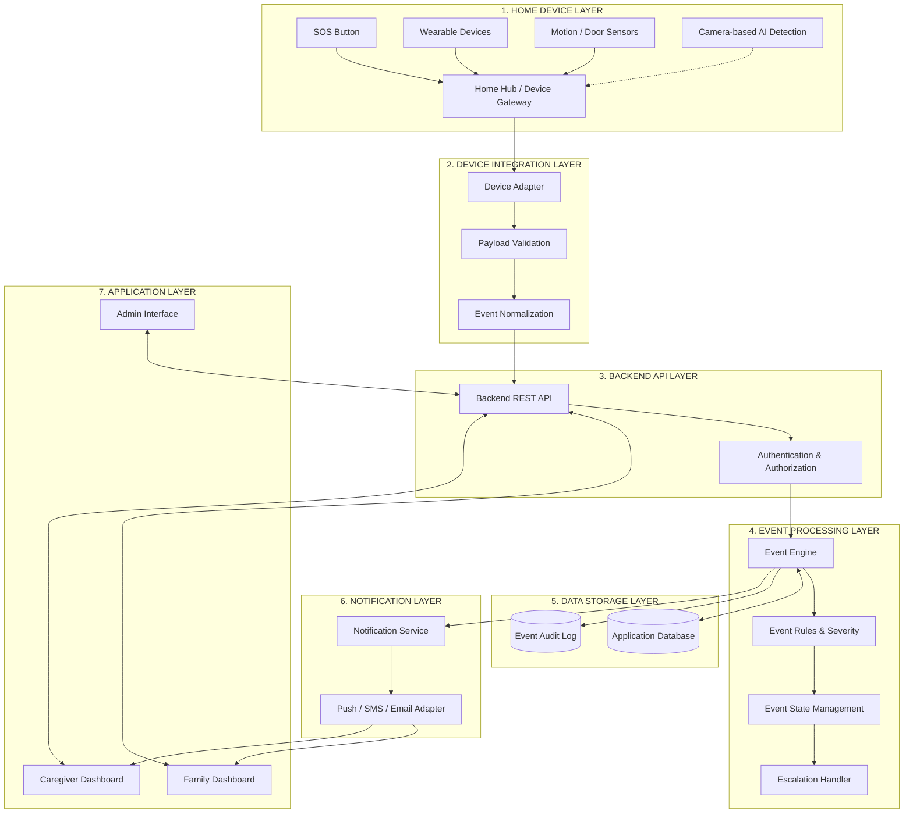
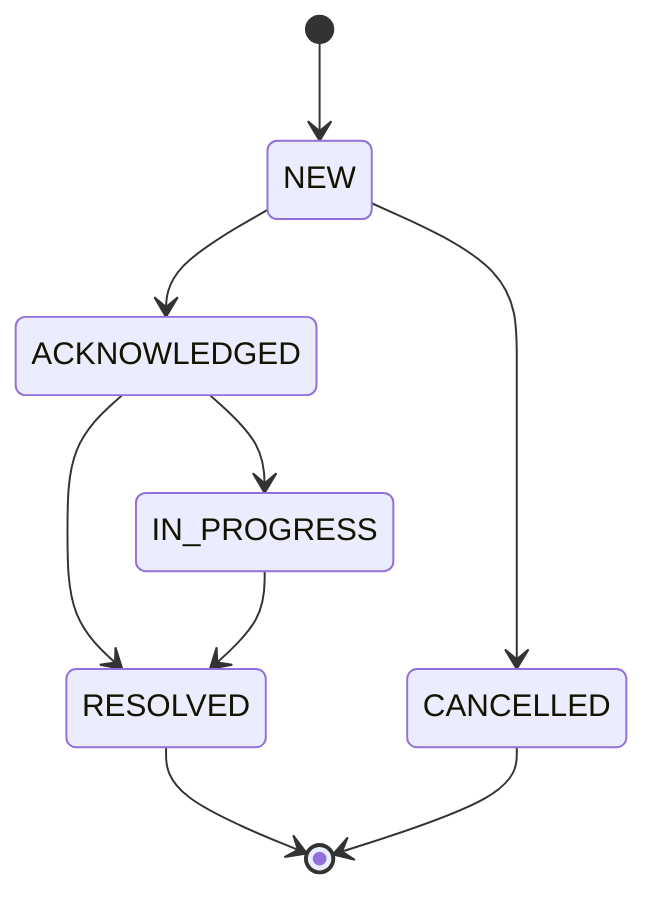
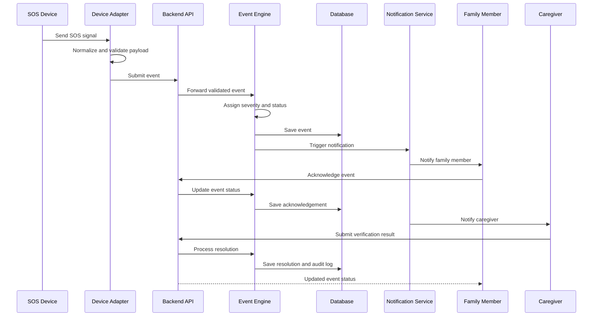

# CARE LOOP — SYSTEM ARCHITECTURE

**Version:** 1.0  
**Status:** Proposed MVP Architecture  
**Project:** CARE LOOP

---

## 1. Architecture Overview

CARE LOOP is designed as a modular, event-driven elderly care and home safety monitoring platform.

The system connects home monitoring devices, event detection modules, backend services, data storage, notification services, and user interfaces into a unified care coordination workflow.

The primary responsibility of the architecture is to ensure that safety-related signals can be received, processed, stored, displayed, and followed up by authorized family members or caregivers.

The MVP focuses on demonstrating the complete event management workflow rather than implementing a fully deployed, production-scale IoT infrastructure.

### Architecture Objectives

- Integrate multiple sources of safety-related events.
- Standardize device data before processing.
- Provide centralized event management.
- Support event acknowledgement and resolution.
- Maintain event history and audit records.
- Monitor device connectivity and health.
- Allow future integration with external AI models and IoT devices.
- Protect personal information through access control and data minimization.

---

## 2. High-Level System Architecture

The system consists of seven main layers:

1. Home Device Layer
2. Device Integration Layer
3. Backend API Layer
4. Event Processing Layer
5. Data Storage Layer
6. Notification Layer
7. Application Layer

### 2.1 Architecture Diagram



**Note:** The diagram represents the proposed logical architecture. Some components, such as physical device gateways, external notification providers, and production authentication, may be simulated or omitted in the initial MVP.

---

## 3. System Components

### 3.1 Home Device Layer

This layer collects safety-related signals from the elderly individual's home environment.

Supported device categories include:

| Device          | Function                                 | Integration Priority |
| --------------- | ---------------------------------------- | -------------------- |
| SOS Button      | Manually trigger an emergency event      | MVP                  |
| Wearable Device | Monitor movement and activity            | Future               |
| PIR Sensor      | Detect motion in a specific area         | Future               |
| Door Sensor     | Monitor door activity                    | Future               |
| mmWave Sensor   | Detect presence and movement             | Future               |
| Camera-based AI | Generate potential fall-detection events | Optional             |
| Home Hub        | Collect and forward device messages      | Future               |

The SOS button is the primary reference input for the initial demonstration because it provides a straightforward way to simulate an emergency event.

The existing AI fall-detection module can be connected as an optional event source.

AI-generated signals must be treated as potential incidents rather than verified medical emergencies.

### 3.2 Device Integration Layer

The Device Integration Layer acts as an intermediary between physical devices and the CARE LOOP backend.

Its main responsibility is to convert device-specific messages into a standardized event format.

Key functions:

- Receive incoming device messages.
- Validate required payload fields.
- Identify the source device.
- Normalize device-specific event types.
- Attach household and device identifiers.
- Forward valid messages to the Backend API.

For the MVP, this layer can be implemented as a lightweight adapter or simulated device interface.

#### Example Normalized Event

```json
{
  "household_id": "HH-001",
  "device_id": "DEV-001",
  "event_type": "SOS",
  "source": "SOS_BUTTON",
  "severity": "HIGH",
  "zone": "living_room",
  "timestamp": "2026-11-19T10:00:00Z"
}
```

### 3.3 Backend API Layer

The Backend API provides the main communication interface between the frontend, device integration layer, and event processing services.

It exposes RESTful endpoints for application operations.

Main responsibilities:

- Receive normalized device events.
- Retrieve active and historical events.
- Handle acknowledgement requests.
- Handle event resolution requests.
- Receive device heartbeat updates.
- Validate user permissions.
- Return structured responses to the frontend.

#### Main API Endpoints

| Method | Endpoint                      | Description                |
| ------ | ----------------------------- | -------------------------- |
| GET    | `/health`                     | Check backend availability |
| GET    | `/api/events`                 | Retrieve event records     |
| POST   | `/api/events`                 | Create a new event         |
| POST   | `/api/events/{id}/ack`        | Acknowledge an event       |
| POST   | `/api/events/{id}/resolve`    | Resolve an event           |
| POST   | `/api/devices/{id}/heartbeat` | Update device status       |

Authentication and authorization should be applied to protected operations before production deployment.

### 3.4 Event Processing Layer

The Event Processing Layer is the core component responsible for managing safety-related events.

It receives normalized events from the Backend API and determines how they should be handled.

Its main components include:

**A. Event Validation**

- Verify event type.
- Verify household and device identifiers.
- Validate required fields.
- Reject malformed messages.
- Prevent duplicate event creation where possible.

**B. Severity Classification**

The Event Engine assigns a default severity based on event type.

| Event Type      | Default Severity |
| --------------- | ---------------- |
| SOS             | HIGH             |
| SUSPECTED_FALL  | HIGH             |
| DEVICE_OFFLINE  | MEDIUM           |
| LOW_BATTERY     | LOW              |
| CHECK_IN_MISSED | MEDIUM           |

Severity levels are configurable and do not represent medical risk assessments.

**C. Event State Management**

Each event follows a defined lifecycle:



| Status       | Description                                            |
| ------------ | ------------------------------------------------------ |
| NEW          | Event has been received                                |
| ACKNOWLEDGED | A responsible person has acknowledged the event        |
| IN_PROGRESS  | Verification or response is ongoing                    |
| RESOLVED     | The event has been handled and documented              |
| CANCELLED    | The event has been cancelled according to the workflow |

Acknowledgement does not mean that an incident has been resolved.

**D. Escalation Handler**

If a high-priority event remains unacknowledged beyond a configured time threshold, the system may escalate it to another designated contact.

For the MVP, escalation can be simulated through dashboard status updates or mock notification records.

A real escalation service requires reliable notification delivery and operational procedures.

### 3.5 Data Storage Layer

The Data Storage Layer maintains application records and event history.

The main data entities include:

| Entity     | Purpose                                |
| ---------- | -------------------------------------- |
| Household  | Stores household information           |
| Person     | Stores users and their roles           |
| Device     | Stores registered device information   |
| CareEvent  | Stores safety-related events           |
| EventAudit | Records actions performed on events    |
| Consent    | Stores data collection consent records |

The database is responsible for maintaining event state, device status, timestamps, and response history.

The initial MVP can use the database technology already available in the project.

### 3.6 Notification Layer

The Notification Layer distributes event information to designated family members and caregivers.

Main responsibilities:

- Identify relevant recipients.
- Generate notification messages.
- Record notification status.
- Support escalation workflows.
- Track notification delivery failures where supported.

Potential notification channels:

- In-app dashboard notifications.
- Push notifications.
- SMS.
- Email.
- Voice calls.

For the initial MVP, dashboard notifications and simulated notification delivery are sufficient.

External notification providers can be integrated in later development phases.

### 3.7 Application Layer

The Application Layer provides interfaces for different user roles.

**A. Family Dashboard**

Allows family members to:

- View household safety events.
- Receive new event alerts.
- Acknowledge incidents.
- Monitor event response status.
- Review incident history.
- View device connectivity information.

**B. Caregiver Dashboard**

Allows caregivers to:

- View assigned incidents.
- Acknowledge alerts.
- Update response progress.
- Record verification results.
- Resolve incidents with explanatory notes.

**C. Admin Interface**

Allows administrators to:

- Manage household information.
- Register and manage devices.
- Configure user roles.
- Review system activity.
- Monitor device health.

---

## 4. End-to-End Data Flow

The following workflow describes how CARE LOOP processes a typical safety incident.

### 4.1 Emergency SOS Workflow



### 4.2 Workflow Description

1. An elderly individual activates the SOS button.
2. The device sends an SOS signal to the Device Adapter.
3. The adapter validates and normalizes the message.
4. The Backend API receives the standardized event.
5. The Event Engine creates a new event with HIGH severity.
6. The event is stored in the database.
7. The Notification Service identifies designated contacts.
8. A family member receives the alert.
9. The family member acknowledges the event.
10. A caregiver verifies the situation.
11. The caregiver submits a resolution note.
12. The Event Engine updates the event status to RESOLVED.
13. The system records the complete event history.

---

## 5. Integration with Existing AI Fall Detection

CARE LOOP can integrate the existing fall-detection repository as an external event producer.

The AI module is responsible for processing video input and generating potential fall-detection signals.

CARE LOOP is responsible for receiving these signals and managing the subsequent response workflow.

### Integration Flow


### Example Integration Payload

```json
{
  "household_id": "HH-001",
  "device_id": "CAM-001",
  "event_type": "SUSPECTED_FALL",
  "source": "AI_FALL_DETECTION",
  "confidence": 0.82,
  "timestamp": "2026-11-19T10:15:00Z"
}
```

The confidence value is illustrative and must not be interpreted as a validated probability of an actual fall.

### Integration Considerations

- The AI module and CARE LOOP backend should remain independent.
- AI output should be converted into the standardized event format.
- Detection confidence may be stored as event metadata.
- The backend should not assume that every detection represents a real fall.
- Human verification is required before an incident is considered resolved.
- Existing limitations in multi-person detection and tracking consistency must be considered during evaluation.

The initial MVP may demonstrate this integration using a sample video and simulated API submission.

---

## 6. Device Health Monitoring

The system should monitor device connectivity through periodic heartbeat messages.

A heartbeat contains information about the device's current operational status.

### Example Heartbeat Payload

```json
{
  "device_id": "DEV-001",
  "household_id": "HH-001",
  "state": "ONLINE",
  "battery_level": 85,
  "timestamp": "2026-11-19T10:20:00Z"
}
```

### Device Status

| Status      | Description                                         |
| ----------- | --------------------------------------------------- |
| ONLINE      | Device is communicating normally                    |
| OFFLINE     | No heartbeat received within the configured timeout |
| LOW_BATTERY | Battery level is below the configured threshold     |
| DISABLED    | Device has been manually disabled                   |

If a device stops sending heartbeat messages, the system should update its status and optionally create a DEVICE_OFFLINE event.

---

## 7. Error Handling and Reliability

The architecture should account for common failures across the device, backend, and notification layers.

### 7.1 Invalid Device Payload

If a device sends incomplete or invalid data:

- Reject the payload.
- Return an appropriate error response.
- Record the validation failure where appropriate.

### 7.2 Duplicate Events

Repeated messages may create duplicate incidents.

The system should use unique event identifiers or idempotency keys to prevent duplicate processing.

### 7.3 Device Disconnection

If a device exceeds its heartbeat timeout:

- Mark the device as OFFLINE.
- Record the last successful heartbeat.
- Generate a device health alert when configured.

### 7.4 Network Failure

A future Home Hub implementation should temporarily buffer events and retry transmission after network connectivity is restored.

This behavior is not assumed to exist in the initial MVP.

### 7.5 Notification Failure

If notification delivery fails:

- Record the failure status.
- Retry according to configured rules.
- Use a fallback contact or channel where available.

The MVP may simulate notification failure and escalation without integrating external providers.

---

## 8. Security and Privacy Considerations

CARE LOOP handles information related to elderly individuals and household activities.

Security and privacy must therefore be considered throughout the architecture.

Key principles:

- Authentication for application users.
- Role-based access control.
- Household-level data isolation.
- Secure communication using HTTPS/TLS.
- Encryption of sensitive stored information.
- Audit logging for important actions.
- Secure device identification and pairing.
- Explicit consent for monitoring activities.
- Data minimization and retention controls.

Camera-based monitoring should remain optional.

Where camera-based AI is used in a future deployment, local inference and minimal video retention should be preferred where technically feasible.

The initial MVP is a prototype and does not establish production-level security compliance.

---

## 9. MVP Implementation Scope

The proposed architecture contains both MVP components and future capabilities.

| Component           | MVP Implementation                | Future Development                    |
| ------------------- | --------------------------------- | ------------------------------------- |
| SOS Input           | Simulated SOS event               | Physical SOS device                   |
| Device Adapter      | Lightweight adapter               | MQTT / IoT gateway                    |
| Backend API         | REST API                          | Production API infrastructure         |
| Event Engine        | Basic rules and state transitions | Advanced rule configuration           |
| Database            | Basic application storage         | Scalable managed database             |
| Notification        | Dashboard / simulation            | Push, SMS, voice                      |
| Family Dashboard    | Basic event management            | Mobile application                    |
| Caregiver Dashboard | Basic response workflow           | Assignment and scheduling             |
| AI Integration      | Optional sample-based integration | Real-time inference integration       |
| Device Health       | Simulated heartbeat               | Physical device monitoring            |
| Security            | Basic prototype controls          | Full authentication and authorization |

---

## 10. Architecture Limitations

The current architecture is a proposed MVP design.

It does not imply that all components have already been implemented or tested.

The initial prototype focuses on:

- Demonstrating event ingestion.
- Processing structured safety events.
- Managing event states.
- Displaying alerts.
- Recording acknowledgement and resolution.
- Demonstrating the integration boundary with AI detection.

The following capabilities require further implementation and validation:

- Real-world hardware integration.
- Reliable offline event buffering.
- Production notification delivery.
- Full authentication and authorization.
- Multi-household deployment.
- Production infrastructure and monitoring.
- AI detection accuracy evaluation.
- Formal privacy and security assessment.

CARE LOOP is intended to support elderly care coordination and human response. It is not a replacement for emergency services, medical professionals, or continuous human supervision.

---

## 11. Future Architecture Roadmap

### Phase 1 — MVP Prototype

- Implement the core Backend API.
- Implement the basic Event Engine.
- Store and retrieve event records.
- Build the event dashboard.
- Demonstrate SOS acknowledgement and resolution.
- Simulate device heartbeat and notifications.

### Phase 2 — Device and AI Integration

- Integrate physical SOS devices.
- Connect selected IoT sensors.
- Integrate the existing fall-detection module.
- Standardize device communication.
- Improve event deduplication and reliability.

### Phase 3 — Pilot Deployment

- Implement production authentication.
- Integrate real notification providers.
- Deploy backend infrastructure.
- Establish consent and data retention policies.
- Evaluate device reliability and AI performance.
- Conduct controlled pilot testing.

### Phase 4 — Platform Expansion

- Support multiple households.
- Add caregiver assignment and scheduling.
- Introduce configurable escalation rules.
- Improve analytics and reporting.
- Expand supported hardware integrations.

---

**Document End**
